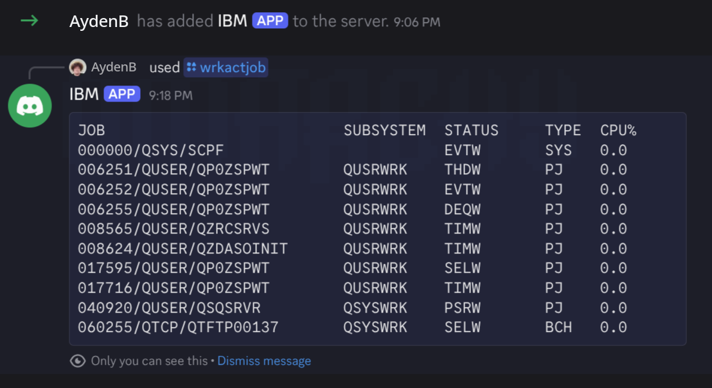

# wrkactjob-bot

A Discord bot that runs IBM i queries for you. Type `/wrkactjob` and it replies with the busiest jobs on your IBM i, sorted by CPU. Every command is just a fixed, read-only SQL query, so adding your own takes a few lines.

It uses the IBM Toolbox for Java (jt400) JDBC driver.



## What you need

- Java 17 or newer
- An IBM i user profile that can run the queries (`QSYS2.ACTIVE_JOB_INFO` needs IBM i 7.3 or newer)
- A Discord account

## 1. Create the Discord bot

1. Go to <https://discord.com/developers/applications> and click **New Application**.
2. Open the **Bot** tab, click **Reset Token**, and copy it. This is your `DISCORD_TOKEN`.
3. Open **OAuth2 > URL Generator**. Tick the scopes `bot` and `applications.commands`. No bot permissions are needed.
4. Open the generated URL and add the bot to your server.

## 2. Configure

Copy `.env.example` to `.env` and fill it in. The bot reads `.env` from the folder you run it in. Real environment variables work too and win over the file.

| Setting | Required | Meaning |
|---------|----------|---------|
| `DISCORD_TOKEN` | yes | Bot token |
| `IBMI_HOST` | yes | IBM i host name or IP |
| `IBMI_USER` | yes | IBM i user profile |
| `IBMI_PASS` | yes | Its password |
| `IBMI_SECURE` | no | `true` encrypts the connection with SSL. Default `false`. Java must trust the IBM i certificate (import its CA into your Java trust store if it uses a private one). |
| `DISCORD_GUILD_ID` | no | Register commands in one server only. They show up instantly. Without it, they can take up to an hour to appear. To find the id, turn on Developer Mode in Discord, right-click the server, and choose Copy Server ID. |
| `REPLY_PUBLIC` | no | `false` (default) keeps replies private to the person who ran the command. `true` posts in the channel. |

The bot needs network access to the IBM i host servers (ports 449 and 8470 to 8476 by default, or the SSL ports 9470 to 9476 with `IBMI_SECURE=true`).

## 3. Run

The easiest way is to download `wrkactjob-bot.jar` from the [Releases page](https://github.com/AydenB/wrkactjob-bot/releases), put your `.env` next to it, and run:

```sh
java -jar wrkactjob-bot.jar
```

To build it yourself instead (needs only Java 17+, the included Maven wrapper downloads Maven):

```sh
./mvnw package
java -jar target/wrkactjob-bot.jar
```

Then in Discord: `/wrkactjob` or `/wrkactjob count:20`.

## Adding your own command

Every command is one entry in the list in `src/main/java/ninja/as400/wrkactjob/Commands.java`. Add a `SqlCommand` with a name, a description, and a SQL statement:

```java
new SqlCommand(
    "sysstatus",
    "Show current IBM i system status",
    "SELECT ACTIVE_JOBS_IN_SYSTEM AS JOBS, AVERAGE_CPU_UTILIZATION AS CPU, "
  + "       CURRENT_TEMPORARY_STORAGE AS TEMP_MB "
  + "  FROM QSYS2.SYSTEM_STATUS_INFO",
    false)
```

Put a comma after the previous entry, rebuild with `./mvnw package`, and restart the bot. The new command shows up in Discord.

Rules for a command:

- **name**: lowercase letters, digits, `-` or `_`, up to 32 characters.
- **description**: up to 100 characters. Discord shows it in the command picker.
- **sql**: must start with `SELECT` or `WITH`. Anything else is rejected when the bot starts. Column aliases (`AS JOBS`) become the table headers.
- **last argument (`takesCount`)**: `false` for a plain query. `true` adds an optional `count` option in Discord, and the SQL must then contain exactly one `?`, normally `FETCH FIRST ? ROWS ONLY`. The count is limited to 1 to 25.

Things to know:

- Discord messages are limited to 2000 characters, so long results are cut off with a note saying how many rows were left out. Pick a few useful columns.
- Queries are fixed in code. Nothing a Discord user types is ever put into the SQL text.
- The connection is opened read-only, but your IBM i user profile is the real safety net. Give it only the authority the queries need.
- Many `QSYS2` services are good candidates, such as `QSYS2.SYSTEM_STATUS_INFO`, `QSYS2.OUTPUT_QUEUE_ENTRIES`, `QSYS2.MESSAGE_QUEUE_INFO` and `QSYS2.SYSDISKSTAT`. Try a query in your usual SQL tool first, then paste it in.

## Security notes

- The bot only runs the fixed `SELECT` statements in `Commands.java`.
- Use a dedicated IBM i profile with minimal authority, not a powerful one.
- Job names and user names appear in Discord. Replies are private by default. Think before turning on `REPLY_PUBLIC` for a server with people who should not see them.
- Anyone in the server who can see the commands can run them. Use Discord's command permissions (Server Settings > Integrations) to limit who can.
- The bot sends nothing anywhere except Discord (the reply) and your IBM i (the query).
- Credentials come from `.env` or the environment only. Never commit `.env`.

## Status

Early version, just a toy. Reports of what works on your IBM i release are welcome in the issues.

## License

MIT. See `LICENSE`.
